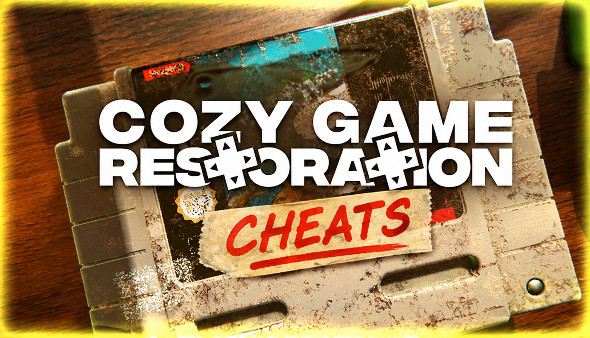

# Cozy Game Restoration — Cheats

**Set your daily allowance, open unlimited packages, auto-clean to grade S, reveal shelf bonuses, unlock all 108 cartridges, fix the stuck-swab bug.**
Free, open source, no installer. Opens with `Insert`.

> **[⬇️ Download the latest Cozy Game Restoration cheats](../../releases/latest)**

    

[Hotkeys](#hotkeys) · [Known bugs](#the-bugs-this-build-shipped-with) · [FAQ](#faq)

---

> [!NOTE]
> Single-player only. No multiplayer, no anti-cheat. Nothing here touches anyone else's collection.

## No timer, no fail state — and the one number that quietly adds both

Parasol Corp put it right on the store page: there is no timer and no fail state. That is true of the cleaning, and the cleaning is why four hundred thousand people put this on a wishlist. It is not quite true of the day around it.

You get a **$10 daily allowance**. Packages cost most of that, so a day is about three cartridges, and three cartridges is roughly where the therapeutic part stops being therapeutic and starts being a shift. Reviewers hit that wall in the first week — not because the scrubbing is bad, but because the allowance decides how much of it you get, and the answer is "less than you want." Then there is the thirty-hour road to all 108 titles, and a collection room whose shelf bonuses are hidden until you have already put something on the shelf.

So the centre of this menu is the allowance slider and nothing more dramatic than that. Set your daily cash to a figure that fits the evening you actually have, open as many parcels as you feel like, and clean every one of them by hand exactly as shipped. The grime is still procedural, the tools still behave, the S grade is still earned with a swab. You have just stopped being rationed.

## The bugs this build shipped with

This is unusual for a page like this, so it is worth saying plainly: several options here exist because of defects in the 1.0 build, not because the game is too hard. They are tagged **`fix`** and they ship **on**.

| What goes wrong | What the option does |
|---|---|
| Swabs and brushes randomly stop scrubbing, or fill with dirt instantly | Resets tool state every stroke |
| Solvent stays visible on a cartridge that already reads 100% | Clears the residue layer when the counter completes |
| Tools will not wipe on the sponge when another object is near it | Removes the proximity check on the sponge |
| Stickers leave residue even after the heat gun | Forces the adhesive layer to resolve on heat |
| Progress will not move between PC and Steam Deck | Writes a portable save copy next to the game |

If Parasol patches these, turn the matching options off. They are workarounds, not improvements, and a fixed game should be played fixed.

## Features

**Money and packages**

| Option | Hotkey | What it does |
|---|---|---|
| Set daily allowance | `F1` | Type any figure. Applies at the next day roll. |
| Set cash | `F2` | Immediate, for the current day |
| Freeze package cost | `F3` | Parcels stop costing anything |
| Unlimited daily packages | `F4` | Removes the per-day cap on parcels you can open |
| Package rarity weight | slider | `1x`–`10x` — how often gold shells, regional variants and sticker art turn up |
| Duplicate sell value | slider | `1x`–`20x` — duplicates are worth almost nothing as shipped |
| Reroll today's parcels | `F5` | New contents without cleaning anything first |

**Cleaning**

| Option | Hotkey | What it does |
|---|---|---|
| Tool state reset `fix` | — | The stuck-swab and instant-fill bug, on by default |
| Solvent residue clear `fix` | — | Clears leftover solvent at 100%, on by default |
| Sponge proximity off `fix` | — | Lets tools wipe when objects are nearby, on by default |
| Adhesive resolves on heat `fix` | — | Stickers stop leaving ghost residue, on by default |
| Clean current cartridge `bypass` | `F6` | Instant 100% on whatever is in your hands — off by default |
| Cleaning strength | slider | `0.5x`–`5x`, default `1x` — how much grime a stroke lifts |
| Infinite solvent and polish | — | Consumables never run down |
| No tool switching delay | — | Number keys swap instantly |
| Grime density | slider | `0%`–`100%` — every cartridge arrives heavily soiled; this thins it |
| Force grade | dropdown | `S` / `A` / `B` / `C` — sets the grade regardless of cleaning |

**Collection**

| Option | Hotkey | What it does |
|---|---|---|
| Reveal shelf bonuses `comfort` | `F7` | Shows what a shelf slot grants *before* you commit a cartridge to it |
| Unlock all 108 titles | — | `save` — fills the collection |
| Complete current quest | `F8` | Collection and calendar quests |
| Unlock all decorations | — | `save` — posters, plants and room cosmetics |
| Free decoration placement `comfort` | — | Removes snap restrictions so decorations stop covering each other |
| Sort inventory by | dropdown | Name, grade, rarity, year — the game only sorts by cleaning order |
| Set in-game date | slider | For calendar quests you missed |

**Comfort and display**

| Option | Hotkey | What it does |
|---|---|---|
| Camera sensitivity `comfort` | slider | `0.2x`–`3x` — the stock camera is heavy on a trackpad |
| Invert scroll zoom `comfort` | — | |
| Interface scale `comfort` | slider | `100%`–`200%` |
| Music track shuffle `comfort` | — | The soundtrack is short and loops fast; this spreads repeats out |
| Mute music only | — | Keeps the scrubbing audio, which is most of the point |
| Portable save copy `fix` `save` | — | Writes a save next to the executable so PC and Deck can share it |
| Free camera | `F11` | Detach and look around the room |
| Hide HUD | `F12` | For screenshots |

Tags — **`fix`**: exists because of a known problem in the 1.0 build, not because the game is hard · **`bypass`**: removes the work the game is built around · **`save`**: writes persistent data · **`comfort`**: accessibility, changes nothing mechanical. Everything tagged `bypass` ships off; everything tagged `fix` ships on.

## Hotkeys

`Insert` opens the menu · `End` resets everything · `F1`–`F12` as above, all rebindable · arrow keys and `Enter` navigate without a mouse

## Grade S without the burnout

The failure mode people report is the same every time: chase 100% on every cartridge, enjoy it for six hours, never open the game again. The cleaning is not the problem — the volume of it at a fixed daily drip is.

> [!TIP]
> The settings that keep this a cozy game: **daily allowance `$60`**, **grime density `70%`**, **reveal shelf bonuses on**, and leave the four `fix` options alone. You open as many parcels as the evening allows, every cartridge still needs real work with swab, brush, tweezers, heat gun and solvent, and you stop having to keep a notebook of which shelf slot does what.

> [!WARNING]
> **Clean current cartridge is the option that ends the game.** Scrubbing is the entire product. Press `F6` a hundred times and you have a complete collection, thirty hours earlier, of things you never touched — and nothing left to do with the room you unlocked. It ships off for a reason.
>
> **Force grade** has the same problem in a quieter way: the S is what the cleaning is for.
>
> Options tagged `save` write persistent data. The game has no cloud save, so your only copy is local — back up `%USERPROFILE%\AppData\LocalLow\Parasol Corp\Cozy Game Restoration` before using them.

## FAQ

Will I get banned?

No. Single-player, no anti-cheat, no online component. Achievements unlock locally — and note that the pre-release build was missing achievements entirely, so if yours are not firing, that is the game rather than this.

How do I get more money in Cozy Game Restoration?

<strong>Set daily allowance</strong> on <code>F1</code> changes the $10 drip to whatever you choose, applied at the next day roll. <strong>Set cash</strong> on <code>F2</code> tops up the current day immediately. Selling duplicates barely moves the needle as shipped, so if you would rather earn it, <strong>Duplicate sell value</strong> at <code>5x</code> makes that a real income instead of a rounding error.

My swab stopped scrubbing — is that your tool?

No, that is a known bug in the 1.0 build, and it happens without anything attached. <strong>Tool state reset</strong> is on by default and works around it. If a patch fixes it properly, turn the option off.

Can I move my save between PC and Steam Deck?

Not normally — the game ships without Steam Cloud. <strong>Portable save copy</strong> writes a second save file next to the executable that you can copy across yourself. It is a workaround; treat the PC copy as the real one.

What do the collection room shelf bonuses actually do?

The game does not tell you until after you have placed a cartridge, which means tracking them by hand. <strong>Reveal shelf bonuses</strong> on <code>F7</code> shows the effect on hover, before you commit.

Does it work on Steam Deck or Linux?

No. Windows only. Proton changes how the game's memory is laid out and this build does not handle that. (The Deck also drains to half battery in about 45 minutes on this game, for what it is worth.)

Windows Defender flagged the download.

Tools like this read and write another process's memory, which is what a lot of malware also does, so heuristic scanners flag them on principle. Every release ships with a SHA256 checksum and full source. Add an exclusion if you are comfortable with that — and if you would rather not, don't. That is a reasonable call.

Options stopped working after an update.

Patches move memory offsets and options fail independently, so some will keep working. Check the Releases page for a build matching your game version — and expect movement, because the 1.0 build has open bugs the developer is likely to address.

## Troubleshooting

| Symptom | Fix |
|---|---|
| Nothing happens on `Insert` | Another overlay grabbed the key — Steam, Discord or RTSS. Rebind the menu key. |
| "Process not found" | The game must be running with a save loaded. Launch it, get into the house, then attach. |
| Allowance change did nothing today | It applies at the next day roll by design. Use **Set cash** for the current day. |
| Shelf bonuses still hidden | The collection room allocates its data when you first open it. Walk in once, then toggle. |
| Decorations still overlap | Free placement only affects items placed after it is on. Pick the item up and set it down again. |
| Collection unlocks vanished | A `save` write was invalidated by a patch. There is no cloud backup, so restore your local copy. |

## Reporting a problem

[Open an issue](../../issues) with your **exact game build number** — that matters more than everything else combined — plus your Windows version, whether the problem is one of the `fix` options or an ordinary one, and which single option misbehaved.

If the issue is a *game* bug rather than one of these options, Parasol Corp would rather hear about it than I would — the four defects listed above are all worth reporting upstream.

## Changelog

**v1.0.0** — 6 November 2026 — first release, two days after launch. 38+ options across money, cleaning, collection and comfort. Four `fix` options ship **on** because they work around defects in the launch build; `Clean current cartridge` and `Force grade` ship **off** and stay off until you turn them on.

---

Unofficial fan tool. Not affiliated with Parasol Corp or Valve. Cozy Game Restoration and all related names and assets belong to their respective owners. Modifying a running game's memory carries some risk of crashes and save corruption — and this game has no cloud save, so back up first. Use at your own risk. MIT licensed.

